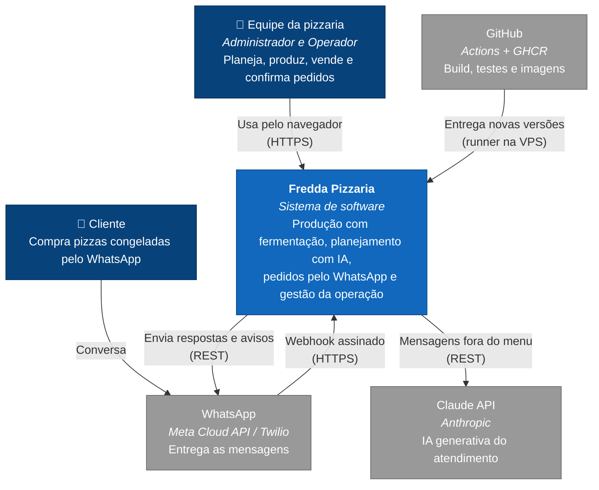
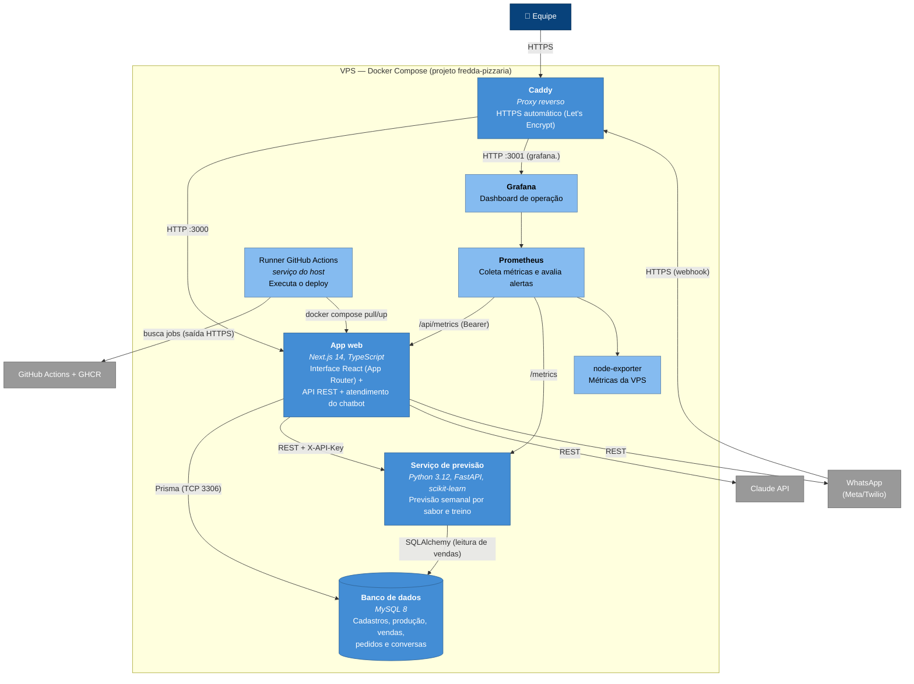
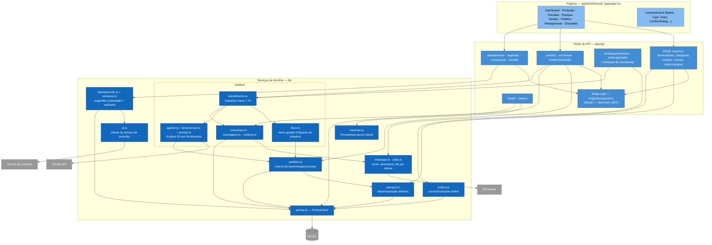

# Arquitetura

A arquitetura segue o modelo [C4](https://c4model.com/) em três níveis: contexto, containers e componentes. Os diagramas usam Mermaid com a notação do C4 (pessoas, sistema, sistemas externos e containers).

**Estilo:** um **monólito modular** em Next.js (interface e API REST no mesmo deploy, com camadas separadas) e um **microsserviço Python** para a previsão de demanda, isolado porque usa outra linguagem, outro ciclo de vida (treino) e outra carga de trabalho. Os motivos estão nas [Decisões Técnicas](Decisoes-Tecnicas).

## Nível 1 — Contexto

## Nível 2 — Containers

Tudo roda em Docker Compose numa VPS (Hostinger, Ubuntu 24.04). Só o Caddy fica exposto na internet.

| Container | Tecnologia | Responsabilidade | Exposição |
|---|---|---|---|
| Caddy | Caddy 2 (host) | Termina o TLS de `pizzafredda.com.br` e `grafana.pizzafredda.com.br` | 80/443 públicas |
| App web | Next.js 14 (Node 24) | Interface, API REST, autenticação, webhooks e chatbot | `127.0.0.1:3000` |
| Serviço de previsão | FastAPI + scikit-learn | `/previsao`, `/treinar`, `/modelo`, `/saude`, `/metrics` | só na rede interna |
| Banco | MySQL 8 | Persistência (volume `mysql_data`) | só na rede interna |
| Prometheus | Prometheus 2.55 | Coleta a cada 30 s, retenção de 15 dias, regras de alerta | só na rede interna |
| Grafana | Grafana 11 | Dashboard provisionado pelo repositório | `127.0.0.1:3001`, com login |
| node-exporter | node-exporter 1.8 | CPU, memória, disco e rede da VPS | só na rede interna |

## Nível 3 — Componentes do app web

O código do app é dividido em camadas: as **páginas** (`app/(dashboard)`) só falam com a **API** (`app/api`), que valida a entrada e a sessão e delega a regra de negócio aos **serviços de domínio** em `lib/`. Os serviços são os únicos que acessam o banco pelo Prisma.

### Padrões aplicados

| Padrão | Onde | Por quê |
|---|---|---|
| **Camadas** (UI → API → domínio → dados) | `app/(dashboard)` → `app/api` → `lib/` → Prisma | Regras de negócio testáveis e reutilizadas pela UI, pelo chatbot e pela IA |
| **Singleton** | `lib/prisma.ts`, `lib/metricas.ts` | Uma conexão/registry por processo, mesmo com o hot reload do `next dev` |
| **Máquina de estados** | `lib/chatbot/fluxo.ts`, status de pedido e de ordem | Transições explícitas, validadas no próprio UPDATE (sem condição de corrida) |
| **Strategy / Adapter** | `lib/whatsapp.ts` × `lib/twilio.ts` | O mesmo atendimento serve à Meta e à Twilio, escolhidos por `WHATSAPP_PROVEDOR` |
| **Chain of responsibility (fallback)** | menu → IA → menu de novo; modelo principal → baseline | O sistema degrada com elegância quando um componente falha |
| **Tool use (function calling)** | `lib/chatbot/ferramentas.ts` | A IA usa as mesmas regras de negócio do menu, sem acesso direto ao banco |
| **Fila por chave** | `enfileirar()` em `lib/whatsapp.ts` | Processa as mensagens de cada cliente em ordem, sem bloquear os demais |

## Fluxo de uma requisição autenticada

1. O navegador chama `/api/...` com o cookie da sessão (JWT do NextAuth).
2. A rota chama `exigirSessao()` ou `exigirSessao('ADMIN')`, que devolve 401/403 se for o caso.
3. A rota valida a entrada e chama o serviço de domínio em `lib/`.
4. O serviço executa a regra numa transação Prisma (ex.: baixa atômica de estoque) e devolve o resultado.
5. A rota responde em JSON; a página mostra o resultado com `Toast` ou `ConfirmDialog`.
