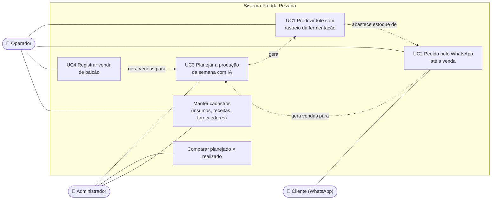
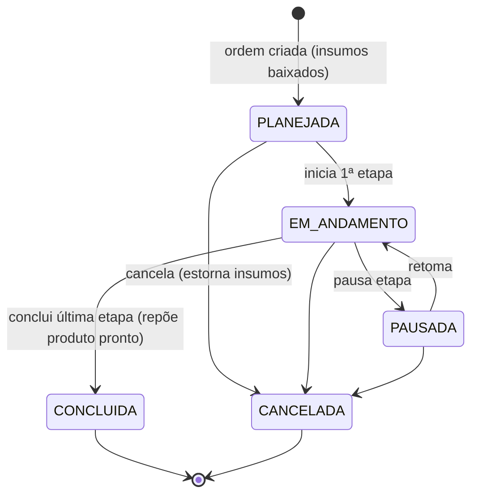
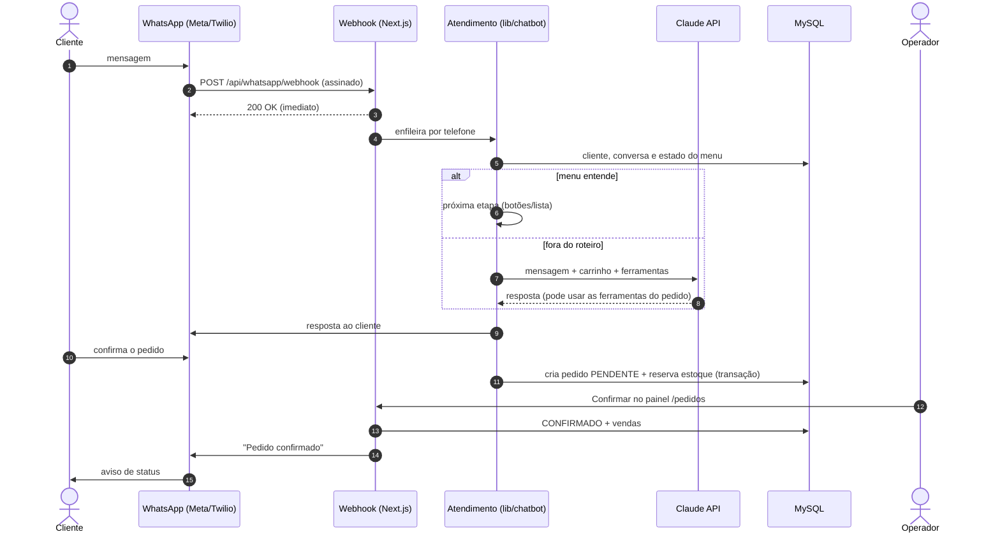
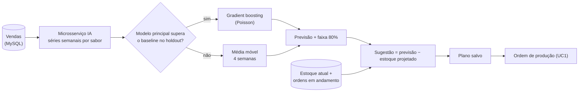

# Casos de Uso

O sistema tem quatro fluxos de negócio completos, ponta a ponta. Os três primeiros são os diferenciais do projeto; o quarto é o fluxo de apoio que alimenta o histórico usado pela IA.

O ciclo fecha assim: as vendas (UC2, UC4) treinam a previsão → a previsão gera o plano e a ordem (UC3) → a ordem produz as pizzas (UC1) → as pizzas abastecem os pedidos (UC2).

---

## UC1 — Produzir um lote com rastreio da fermentação

| | |
|---|---|
| **Ator** | Operador |
| **Pré-condição** | Receitas com ficha técnica cadastrada; usuário autenticado |
| **Pós-condição** | Insumos baixados; ao concluir, o estoque de pizzas prontas de cada sabor aumenta |
| **Requisitos** | RF13–RF18 |

**Fluxo principal**
1. O operador cria uma ordem com os sabores, as quantidades e a data prevista (ou a ordem vem do planejamento, UC3).
2. O sistema soma o consumo de cada insumo pelas fichas técnicas e, numa transação, cria a ordem com as 5 etapas de fermentação e baixa os insumos (registrando a movimentação de saída).
3. O operador inicia a primeira etapa; o timer começa a contar e a ordem passa a "Em andamento".
4. Durante a etapa, o operador registra temperatura, umidade e observações.
5. O operador conclui a etapa e inicia a seguinte, até o congelamento.
6. Ao concluir a última etapa, o sistema conclui a ordem e soma as quantidades produzidas ao estoque de produto pronto de cada receita.

**Fluxos alternativos**
- 2a. Insumo insuficiente para a ordem inteira (somando todas as receitas que o usam) → a ordem é criada mesmo assim, só o saldo existente é baixado e a tela mostra o aviso de falta por insumo. A falta não bloqueia: a compra pode chegar antes da etapa que usa o insumo.
- 3a. Já existe uma etapa em andamento na ordem → o sistema recusa iniciar outra.
- 5a. O operador pausa a etapa → o tempo decorrido é guardado e a ordem fica "Pausada".
- 6a. O operador cancela a ordem → os insumos baixados são estornados. Uma ordem concluída ou cancelada não pode ser alterada.

---

## UC2 — Pedido pelo WhatsApp até a venda

| | |
|---|---|
| **Atores** | Cliente (inicia), Operador (confirma) |
| **Pré-condição** | Receitas ativas com preço de venda e estoque de produto pronto |
| **Pós-condição** | Pedido entregue, com vendas registradas; ou cancelado, com o estoque devolvido |
| **Requisitos** | RF23–RF31 |

**Fluxo principal**
1. O cliente manda uma mensagem; a Meta (ou a Twilio) chama o webhook, que valida a assinatura e responde 200 na hora.
2. O atendimento, numa fila por cliente, identifica o cliente pelo telefone e mostra o menu.
3. O cliente escolhe sabores e quantidades, informa nome, retirada ou entrega, endereço e forma de pagamento.
4. O sistema mostra o resumo com o total calculado a partir do cardápio; o cliente confirma.
5. O sistema cria o pedido "Aguardando confirmação" e, na mesma transação, reserva o estoque de produto pronto.
6. O pedido aparece no painel `/pedidos`; o operador confirma, e o sistema gera uma venda por item e avisa o cliente.
7. Na entrega, o operador marca o pedido como entregue; as vendas ficam como entregues e o cliente é avisado.

**Fluxos alternativos**
- 3a. O cliente escreve algo fora do menu → a IA (Claude) responde com o contexto do carrinho e oferece "Continuar pedido". Se não souber, chama um atendente.
- 3b. A IA está desligada ou falhou → o sistema diz que não entendeu e repete as opções da etapa.
- 3c. O cliente pede um atendente → a conversa passa para a equipe e o bot fica em silêncio até ser devolvido.
- 5a. O estoque acabou entre a escolha e a confirmação → o pedido é recusado com aviso ao cliente.
- 6a. O cliente cancela pelo menu "Meus pedidos" enquanto o pedido aguarda confirmação, ou a equipe cancela → o estoque é devolvido e as vendas, se houver, são removidas.

---

## UC3 — Planejar a produção da semana com IA

| | |
|---|---|
| **Ator** | Administrador (também o Operador, exceto retreinar) |
| **Pré-condição** | Histórico de vendas; microsserviço de previsão no ar |
| **Pós-condição** | Plano da semana salvo e, opcionalmente, ordem de produção criada |
| **Requisitos** | RF32–RF36 |

**Fluxo principal**
1. O administrador escolhe uma semana (da próxima até 7 semanas à frente).
2. O app pede ao microsserviço a previsão por sabor até aquela semana, com intervalo de 80%.
3. O app calcula o estoque projetado (estoque atual + ordens em andamento − demanda prevista até a semana) e a sugestão (previsão − estoque projetado).
4. O administrador escolhe planejar pela previsão ou pelo limite superior, ajusta as quantidades e salva o plano.
5. O administrador cria a ordem de produção com as quantidades planejadas (segue no UC1).
6. Semanas depois, a tela de comparação mostra previsão × planejado × produzido × vendido.

**Fluxos alternativos**
- 2a. Microsserviço fora do ar ou sem histórico → a tela avisa e o plano é feito à mão.
- 2b. Sabor com menos de 12 semanas de histórico → a previsão usa o baseline (média móvel de 4 semanas).
- 6a. O administrador retreina o modelo → um segundo treino simultâneo é recusado (409).

---

## UC4 — Registrar venda de balcão

| | |
|---|---|
| **Ator** | Operador |
| **Pré-condição** | Estoque de produto pronto do sabor |
| **Pós-condição** | Venda registrada e estoque de produto pronto baixado |
| **Requisitos** | RF19–RF22 |

**Fluxo principal**
1. O operador informa cliente, sabor, quantidade, preço, forma de pagamento e, se houver, a data de entrega.
2. O sistema baixa o estoque de produto pronto de forma atômica e registra a venda.
3. Depois, o operador marca a venda como paga e/ou entregue.

**Fluxos alternativos**
- 2a. Estoque insuficiente → a venda é recusada.
- 3a. O administrador cancela a venda → o estoque é estornado.
