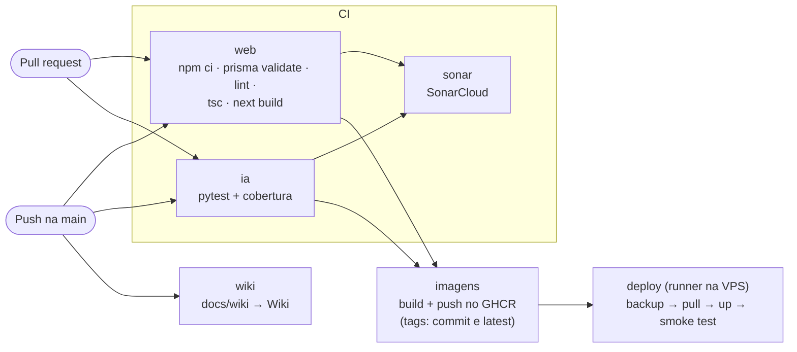

# Deploy e Infraestrutura

## Ambientes

| Ambiente | Onde | Como sobe | Dados |
|---|---|---|---|
| **Desenvolvimento** | Máquina do desenvolvedor | `npm run dev` + MySQL no Docker (`docker-compose.dev.yml`), ou tudo com `docker compose up --build` | Seed (`npm run db:seed`) e dados sintéticos para a IA |
| **CI** | Runners do GitHub | A cada PR e push: build, lint, tipos, testes e análise | Nenhum (build sem banco) |
| **Produção** | VPS Hostinger (Ubuntu 24.04), https://pizzafredda.com.br | Pipeline, a cada push na `main` | Banco real (volume `fredda-pizzaria_mysql_data`), com backup antes de cada deploy |

As instruções para rodar localmente estão no [README](https://github.com/DiegoPlaninscheck/fredda-pizzaria#-como-rodar-localmente).

## Pipeline CI/CD

Arquivo: [`.github/workflows/ci-cd.yml`](https://github.com/DiegoPlaninscheck/fredda-pizzaria/blob/main/.github/workflows/ci-cd.yml).



| Job | Quando | O que faz |
|---|---|---|
| `web` | PR e push | Instala as dependências, valida o schema do Prisma, roda o ESLint, checa os tipos e faz o build de produção |
| `ia` | PR e push | Roda os testes do serviço de previsão com cobertura (`coverage.xml` vai para o Sonar) |
| `sonar` | PR e push | Análise do SonarCloud (pulada em PRs de fork, que não recebem secrets) |
| `imagens` | push na `main` | Builda as imagens `fredda-pizzaria-app` e `fredda-pizzaria-ia` e publica no GHCR com cache |
| `deploy` | push na `main`, depois de `imagens` | Roda **na VPS**, pelo runner self-hosted: confere o `.env`, faz backup do banco, baixa as imagens do commit, recria os containers e testa `/api/health` |
| `wiki` | push na `main` | Publica `docs/wiki/` na Wiki do GitHub |

Além dele: [`codeql.yml`](https://github.com/DiegoPlaninscheck/fredda-pizzaria/blob/main/.github/workflows/codeql.yml) (segurança) e [`dependabot.yml`](https://github.com/DiegoPlaninscheck/fredda-pizzaria/blob/main/.github/dependabot.yml) (atualizações). Ver [Qualidade](Qualidade).

### Por que um runner na VPS

O runner self-hosted abre uma conexão de **saída** para o GitHub e busca os jobs; o GitHub nunca acessa a VPS. Assim não há porta SSH aberta para o pipeline nem chave da VPS guardada no GitHub. Os riscos e as mitigações estão no [ADR-010](Decisoes-Tecnicas#adr-010--deploy-por-runner-self-hosted-e-imagens-no-ghcr).

## Produção

```text
Internet ──443──► Caddy (host, systemd)
                    ├── pizzafredda.com.br          ──► 127.0.0.1:3000  app (Next.js)
                    └── grafana.pizzafredda.com.br  ──► 127.0.0.1:3001  grafana
Rede interna do compose: app ⇄ db (MySQL) · app ⇄ ia (FastAPI) · prometheus ⇄ app/ia/node-exporter
```

| Item | Valor |
|---|---|
| Projeto do compose | `fredda-pizzaria` (fixo no `docker-compose.yml`, para os volumes serem sempre os mesmos) |
| Configuração | `/opt/fredda/.env` (nunca vai para o Git) |
| Backups | `/opt/fredda/backups/fredda-AAAAMMDD-HHMMSS-<commit>.sql.gz` (os 7 mais recentes) |
| Imagens | `ghcr.io/diegoplaninscheck/fredda-pizzaria-{app,ia}:<commit>` |
| Migrations | Aplicadas no start do container do app (`prisma migrate deploy` em `docker-entrypoint.sh`) |
| Reinício | `restart: unless-stopped` em todos os serviços; o runner e o Caddy são serviços do systemd |
| Logs | Driver `json-file` com rotação (3 × 10 MB por container): `docker logs fredda_app` |

### Variáveis obrigatórias em produção

O job de deploy falha se alguma estiver vazia: `NEXTAUTH_SECRET`, `MYSQL_PASSWORD`, `IA_API_KEY`, `METRICS_TOKEN` e `GRAFANA_ADMIN_PASSWORD`. A lista completa, com explicações, está no [`.env.example`](https://github.com/DiegoPlaninscheck/fredda-pizzaria/blob/main/.env.example).

### Provisionamento da VPS (feito uma vez)

1. Instalar Docker e Caddy; apontar `pizzafredda.com.br` e `grafana.pizzafredda.com.br` (registro A) para o IP da VPS.
2. Liberar só as portas 80 e 443 no firewall (o app e o Grafana escutam em `127.0.0.1`).
3. Criar o usuário do runner e as pastas:
   ```bash
   useradd -m -s /bin/bash github-runner && usermod -aG docker github-runner
   mkdir -p /opt/fredda/backups && chown -R github-runner: /opt/fredda && chmod 700 /opt/fredda
   # copiar o .env para /opt/fredda/.env (chmod 600)
   ```
4. Instalar o runner como `github-runner`, seguindo **Settings → Actions → Runners → New self-hosted runner** (Linux x64), com o label `producao`, e registrá-lo como serviço (`sudo ./svc.sh install github-runner && sudo ./svc.sh start`).
5. No Caddy (`/etc/caddy/Caddyfile`):
   ```caddy
   pizzafredda.com.br {
       encode gzip
       reverse_proxy localhost:3000
   }
   grafana.pizzafredda.com.br {
       reverse_proxy localhost:3001
   }
   ```
   e `systemctl reload caddy`.
6. No GitHub: **Settings → Actions → General → "Require approval for all external contributors"** e criar o environment `production`.

## Operação

**Rollback.** Em **Actions**, abrir a execução do commit anterior que estava bom e clicar em **Re-run jobs → deploy**. As imagens são marcadas pelo commit, então a versão volta exatamente como estava. Se uma migration tiver alterado o banco, restaurar o backup feito antes do deploy:

```bash
gunzip -c /opt/fredda/backups/<arquivo>.sql.gz | docker exec -i fredda_db sh -c 'exec mysql -uroot -p"$MYSQL_ROOT_PASSWORD" "$MYSQL_DATABASE"'
```

**Retreinar o modelo** depois do primeiro deploy (ou pelo botão "Retreinar modelo" no Planejamento, como ADMIN): ver [`ia/README.md`](https://github.com/DiegoPlaninscheck/fredda-pizzaria/blob/main/ia/README.md#microsserviço-fastapi).

**Ver o estado dos containers** (na VPS): `docker compose -p fredda-pizzaria ps` e `docker logs --tail 100 fredda_app`.
