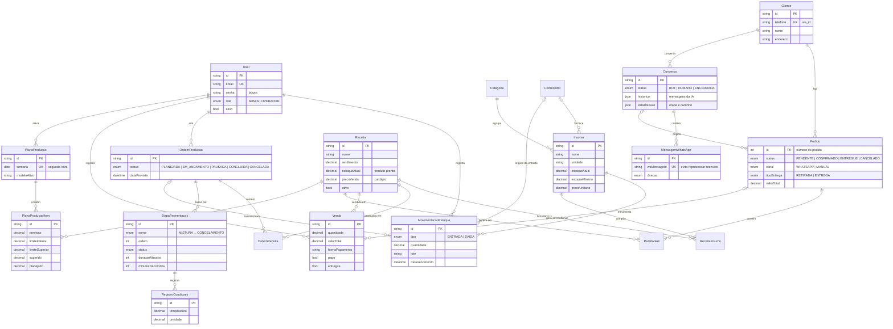

# Modelo de Dados

Banco relacional MySQL 8, acessado pelo Prisma. A definição completa está em [`prisma/schema.prisma`](https://github.com/DiegoPlaninscheck/fredda-pizzaria/blob/main/prisma/schema.prisma), e o histórico de mudanças, em `prisma/migrations/`. São 20 models em quatro áreas.

## Regras de integridade importantes

| Regra | Como é garantida |
|---|---|
| Estoque (de insumo e de produto pronto) nunca negativo | `updateMany` com condição `estoqueAtual >= quantidade` dentro da transação (`lib/estoque.ts`); se nenhuma linha é afetada, a operação é desfeita |
| Pedido/ordem não muda de status duas vezes | O UPDATE filtra pelo status esperado (`transicionar()` em `lib/pedidos.ts`, `finalizar()` em `lib/ordens.ts`) |
| Mensagem do WhatsApp processada uma única vez | `MensagemWhatsApp.waMessageId` é único; o reenvio da Meta cai na violação de unicidade e é ignorado |
| Preço do pedido congelado no momento da compra | `PedidoItem.precoUnitario` copia o `precoVenda` atual; mudanças no cardápio não alteram pedidos antigos |
| Um plano por semana | `PlanoProducao.semana` é único (sempre a segunda-feira, no horário de Brasília) |
| Ingrediente aparece uma vez por receita | `unique(receitaId, insumoId)` em `ReceitaInsumo`; o mesmo vale para `OrdemReceita` |
| Exclusão lógica | Cadastros usam `ativo = false` em vez de apagar, preservando o histórico de vendas e produção |
